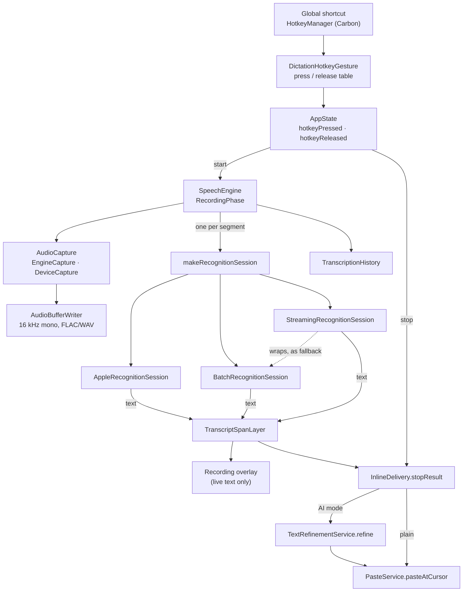

# Architecture

A short map of the code for someone about to change it. [CLAUDE.md](../CLAUDE.md) is the full reference — every decision and the measurement behind it — and this page points into it rather than repeating it. Where the two disagree, the code wins, then CLAUDE.md.

## What the app is

SpeechText is a macOS menu bar agent (`LSUIElement`, no window at launch). A global shortcut starts a recording; speech is turned into text by one of several engines — Apple's on-device recogniser, a model on this Mac, or a cloud service — optionally rewritten by an LLM, and pasted at the cursor of the app in front.

The app's views, state, engine runtimes and stores are in `SpeechText/SpeechText/`; its logic is in a local Swift package, `Packages/SpeechTextCore` (`Sources/SpeechTextCore/`, and `Sources/ChatTemplates/` as a product of its own). The Xcode project has four targets:

| Target | What it is |
|---|---|
| **SpeechText** | The app. |
| **SpeechTextTests** | The unit tests. A *standalone* bundle — no `TEST_HOST`, no `@testable import` of the app — that tests the package through `@testable import SpeechTextCore` (see [Invariants](#invariants)). |
| **SpeechTextEvaluation** | A command-line tool, its own scheme, that runs the audio corpus through the local engines the test bundle cannot load, and exports the model catalogues. It links SpeechTextCore and compiles the engine runtimes itself. Built by CI, never run there; ships nothing. |
| **SpeechTextLLM** | An XPC service inside the app (`Contents/XPCServices/SpeechTextLLM.xpc`) that runs AI Rewrite on this Mac with llama.cpp, so a crash or an out-of-memory model ends the service, not the dictation. |

Everything else is Apple frameworks, plus four third-party packages, each imported by as few files as possible:

| Dependency | For | Imported only by |
|---|---|---|
| WhisperKit | Local Whisper models | `LocalWhisperRuntime.swift` |
| FluidAudio | Local Parakeet models; the Silero voice activity detector | `LocalParakeetRuntime.swift`, `VoiceActivityRuntime.swift` |
| Sparkle | Updates | `UpdateChecker.swift` |
| llama.cpp (`Packages/LlamaBinary/`) | AI Rewrite on this Mac | `LocalLlamaRuntime.swift` — compiled into SpeechTextLLM and SpeechTextEvaluation, never into the app |

The rule behind that table is in [ROADMAP.md](../ROADMAP.md) (“Third-party dependencies, beyond the four we have”).

## The main flow: an inline dictation

**Shortcut.** `HotkeyManager` registers the four global shortcuts with Carbon's `RegisterEventHotKey` and reports each press and release. `DictationHotkeyGesture` (`DictationHotkeys.swift`) is a pure table that turns a press or release in a given phase into an action — start, stop, cancel, switch between plain and AI mode, lock a hold-to-talk dictation on. `AppState.hotkeyPressed` / `hotkeyReleased` (`App.swift`) supply the phase and perform the action.

**Recording.** `AppState` remembers the app that was in front and asks `SpeechEngine` to start. The engine reads one `RecordingConfiguration` snapshot (engine, model, keys, languages), opens a capture — `EngineCapture` on the system input, or `DeviceCapture` bound to one device when the microphone choice names one — and appends every buffer to an `AudioBufferWriter`, which converts to 16 kHz mono as audio arrives. The engine's state is a single `RecordingPhase` (idle / starting / recording / paused / finishing); the booleans the views read are computed from it.

**Recognition.** For every segment (a resume after a pause starts a new one), `makeRecognitionSession` (`RecognitionSessionFactory.swift`) — the one place that knows which tier a configuration selects — builds a `RecognitionSession`:

- `AppleRecognitionSession` — `SFSpeechRecognizer` on device, rotated every 50 s.
- `BatchRecognitionSession` — at the stop, writes the writer's file and uploads it through a `BatchTranscriber` (Groq, OpenAI, ElevenLabs, or a model on this Mac through the `LocalSTT` box).
- `StreamingRecognitionSession` — a realtime WebSocket (`StreamingTranscriber`) for live text, *wrapping* a `BatchRecognitionSession` that uploads the same file if the stream fails, drops, ran too long or answered nothing.

The upload and streaming sessions guard what they hand back: a segment too short or silent, one with no voice in it (`VoiceActivity`), or a result that is a known hallucination (`HallucinationFilter`) is dropped rather than pasted. A session reports `.live(committed:partial:)` events while the user speaks and a `RecognitionOutcome` at the end; the engine — not the session — writes History.

**Live text.** `TranscriptSpanLayer` turns the sessions' cumulative committed and partial strings into spans with identity, so a partial that becomes a commit is replaced in place rather than appended twice. The overlay draws the spans; nothing goes to another app yet.

**Stop.** `AppState.stopRecording` fixes the destination first — `InlineDelivery.destination`, the app in front at the stop — then waits for the engine. `InlineDelivery.stopResult` decides what the one write is, from the span layer's text for the whole recording: paste it, hand it to the LLM in AI mode, report no speech, or on a failure hand what there is to the Record Window. In AI mode `TextRefinementService.refine` sends the transcript (with the `<context>` of the destination app and the Dictionary's `<vocabulary>`); the model picks a prompt and rewrites; any failure pastes the transcript as dictated. `PasteService.pasteAtCursor` puts the text on the clipboard, posts ⌘V and restores the clipboard afterwards. Without Accessibility, or with no app to paste into, the text opens in the Record Window instead.

**Record Window.** The ⌃⇧W panel (`DirectRecordingPanel.swift`) runs the same `SpeechEngine` but owns its surface: each finished segment is inserted into its own text view by `TextInsertionHandler`, and with ✨ on each segment is rewritten in place through `TextRefinementService` and `FinalizePass.plan`. Its button rail inserts the text at the cursor of the app you came from, or copies it.

**Edit selection.** The ⌃⇧E flow, gestures in `EditHotkeyGesture` (`SelectionEdit.swift`): `PasteService.readSelection` reads the selected text, the microphone records a spoken instruction (never pasted), the selection is read again and cut when the instruction ends (`PasteService.cutSelection`), `TextRefinementService.edit` rewrites it, and the result is pasted where the selection was. Any failure pastes the original back.

## File map

Files listed by layer, with the types worth knowing first. Not every file is here.

### Pure logic — `Packages/SpeechTextCore`

These have no SwiftUI views, no `AppState`, no `SpeechEngine`. The package's manifest declares no dependency, so none of them can import WhisperKit, FluidAudio, Sparkle or llama, and CI refuses `import SwiftUI` there.

| Area | Files and key types |
|---|---|
| Sessions | `RecognitionSession.swift` (`RecognitionSession`, `RecognitionEvent`, `RecognitionOutcome`, `RecognitionFailure`), `BatchRecognitionSession.swift`, `StreamingRecognitionSession.swift`, `OpenSegmentClock.swift` |
| Providers | `Transcribers.swift` (`BatchTranscriber`, `makeBatchTranscriber`, `STTTuning`), `StreamingTranscribers.swift` (`StreamingTranscriber`, `makeStreamingTranscriber`), `ProviderRegistry.swift` (`Provider`, `ProviderDescriptor`), `STTModelCatalog.swift`, `ChatClients.swift` (`ChatClient`, `LLMConfiguration`), `ModelLifecycle.swift`, `ModelLanguages.swift` |
| Settings | `RecordingConfiguration.swift`, `Settings.swift` (`SettingsKeys`), `APIKeyStore.swift` (`APIKeyStore`, `SecretStorage`), `MicrophoneChoice.swift` |
| Text | `TranscriptSpan.swift` (`TranscriptSpanLayer`), `TranscriptMerge.swift`, `TranscriptCleanup.swift`, `HallucinationFilter.swift`, `VoiceActivity.swift`, `Vocabulary.swift`, `TextReplacements.swift`, `CustomVocabulary.swift` |
| Delivery and AI | `InlineDelivery.swift`, `DictationHotkeys.swift` (`DictationHotkeyGesture`, `HoldTip`), `SelectionEdit.swift` (`EditHotkeyGesture`, `CapturedSelection`), `InsertionLedger.swift`, `DeliveryTier.swift`, `FinalizePass.swift`, `FocusContext.swift`, `TextRefinementService.swift`, `PromptPresets.swift` |
| Local models | `LocalModelCatalog.swift` (`LocalSTT` registration box, `MacTier`), `LocalChatCatalog.swift` (`LocalChat` box), `ChatTemplates.swift` (the ChatTemplates product), `SystemCapabilities.swift` |
| History and usage | `TranscriptionHistory.swift` (`TranscriptionRecord`), `HistorySummary.swift`, `HomeSummary.swift`, `UsageSummary.swift`, `NetworkFailure.swift`, `OfflineRetryQueue.swift`, `RateLimits.swift`, `DictationTrace.swift`, `DebugLog.swift` |
| Overlay | `OverlayPlacement.swift` (where the overlay sits, as geometry) |

### App-only services

| File | What it owns |
|---|---|
| `App.swift` | `AppDelegate` (status menu, launch migrations) and `AppState` (the dictation, edit and Record Window flows, overlay, paste-back) |
| `SpeechEngine.swift` | The microphone, the writer, `RecordingPhase`, device-change restarts, History bookkeeping |
| `AudioCapture.swift`, `AudioInputDevices.swift` | `EngineCapture`, `DeviceCapture`; Core Audio device lists |
| `RecognitionSessionFactory.swift`, `AppleRecognitionSession.swift` | Tier selection; Apple's recogniser |
| `HotkeyManager.swift` | Carbon hotkeys, `HeldShortcuts`, `HotkeyRegistrationStatus` |
| `PasteService.swift` | Clipboard, ⌘V/⌘C/⌘X, every Accessibility read of another app |
| `LocalSTTRuntime.swift`, `LocalWhisperRuntime.swift`, `LocalParakeetRuntime.swift`, `VoiceActivityRuntime.swift` | The local speech engines and the voice detector, registered into their boxes at launch |
| `LocalModelStore.swift`, `LocalChatStore.swift` | Downloads and install state of local models |
| `LocalChatClient.swift`, `LocalChatXPC.swift` | The app's side of the SpeechTextLLM service |
| `KeychainSecretStorage.swift` | The keychain backing `APIKeyStore` in signed builds |
| `HistoryRetry.swift`, `OfflineRetry.swift` | Retrying archived audio, by hand and when the network returns |
| `UpdateChecker.swift`, `AppInstaller.swift`, `DockIcon.swift`, `DebugLogView.swift` | Updates, the move to Applications, the Dock icon, the log window |

### UI

| Files | Surface |
|---|---|
| `RecordingOverlay.swift` | The inline overlay and status notices (placed by `OverlayPlacement`) |
| `DirectRecordingPanel.swift` | The Record Window |
| `MainWindow.swift`, `HomeView.swift`, `HistoryView.swift`, `UsageView.swift`, `PromptsView.swift`, `DictionaryView.swift`, `MainPageKit.swift` | The main window and its pages |
| `SettingsWindow.swift`, `SettingsView.swift` (`SettingsView`), `SettingsEngines.swift` | Settings |
| `Onboarding*.swift` | First-run setup |
| `Theme.swift`, `DesignKit.swift`, `PixelDisplay.swift`, `MinimalChrome.swift` | The two skins, minimal and techno |

## Invariants

Each of these was learned the hard way. Break one only on purpose, and update CLAUDE.md with it.

- **Nothing reaches another app before the stop.** Live text lives on the overlay only; text pasted into a foreign document cannot be taken back. — CLAUDE.md › Key Patterns › *Nothing reaches another app before the stop*
- **One write at the stop**, built from the whole recording (`spanLayer.text`), never from the last segment. — *One write at the stop*
- **Streaming rides alongside the audio file, never instead of it.** The stream is for live text; the file is always written, and the upload answers whenever the stream cannot be trusted. — *Streaming rides alongside the audio file, never instead of it*
- **Settings are snapshotted per session.** Provider, model and key are read once at start; History retry is the one place that reads fresh settings. — *Settings are snapshotted per session*
- **SpeechTextCore stays closed.** No `TEST_HOST`; logic the tests need goes in `Packages/SpeechTextCore`, together with what it depends on, and needs no project edit; a package file never reaches into views, `AppState` or `SpeechEngine`. The manifest declares no dependency, so an engine's import there does not build, and CI's *Core imports* check refuses `import SwiftUI`. — CLAUDE.md › Tests, and [development.md](development.md#tests)
- **The local tier is reached through registration boxes.** `LocalSTT`, `LocalChat` and `VoiceActivity.detector` are filled at launch (`registerLocalSTT()`, `registerLocalChat()`, `registerVoiceActivity()`); unregistered, they fail or judge nothing rather than return empty text. — *Registration, not imports, for the local tier*
- **API keys go through `APIKeyStore`.** Never read or write a key with `UserDefaults` directly: in a signed build they live in the keychain. — *API keys live in the keychain when the build can reach it*, and [development.md](development.md#api-keys)
- **No telemetry or analytics of any kind.** — [ROADMAP.md](../ROADMAP.md)

## How to test what

| What you changed | How it is tested | Where |
|---|---|---|
| Pure logic (parsing, merging, catalogues, settings derivations) in SpeechTextCore | Unit tests in SpeechTextTests; `xcodebuild test … -scheme SpeechText` | [development.md](development.md#tests) |
| The path from provider events to the paste | `DictationReplay`: scripted provider events through the real sessions, span layer and `InlineDelivery` into fake apps; asserts nothing is pasted before the stop | `SpeechTextTests/DictationReplay.swift` |
| A real dictation that went wrong | Record a trace (Debug Log › Record traces), import it, replay it with `RecordedTraceTests` — traces stay outside the repository | `scripts/import-trace.sh`, `scripts/replay-traces.sh` |
| Engine accuracy, guards against noise | The audio corpus through the real engines (`LiveProviderTests`, SpeechTextEvaluation) | [audio-corpus.md](audio-corpus.md), `scripts/evaluate.sh` |
| The whole app, with real shortcuts and a real paste | The e2e harness, on your Mac, never in CI | [e2e.md](e2e.md), `scripts/e2e.sh` |

What none of these can show — a real microphone, a permission prompt, a paste into an app the e2e run cannot read back — goes under *Needs a real-app run* in the pull request.
